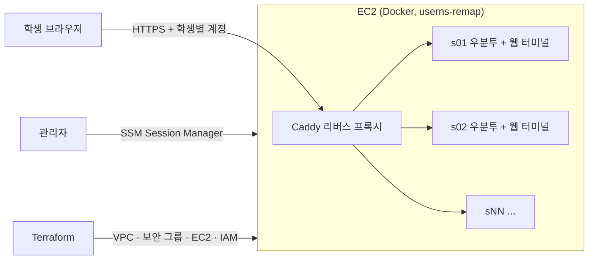

# Campus Cloud Lab

브라우저만 있으면 되는 리눅스 실습실. 학생마다 격리된 우분투 환경을 AWS 위 컨테이너로 띄우고, 수업이 끝나면 한 번에 내린다.

## 왜 만들었나

대학 리눅스 실습 수업에서는 실습실 PC마다 가상머신을 설치하고 우분투 이미지를 내려받아 각자 환경을 만든다. 환경 준비가 PC 사양과 설치 과정에 좌우되고, 수업이 끝나면 그 환경도 PC에 묶인 채 남는다.

이 프로젝트는 같은 실습을 클라우드로 옮겼을 때 무엇이 나아지고, 비용과 보안은 어떻게 감당하는지 직접 만들어 확인한다.

## 구조 (목표)

- 학생 컨테이너끼리는 네트워크가 분리돼 서로 접근할 수 없다.
- 학생마다 CPU·메모리·프로세스 수를 제한한다.
- 관리자는 SSH 포트를 열지 않고 SSM으로 접속한다.

설계 이유는 [docs/decisions.md](docs/decisions.md)에 있다.

## 진행 단계

- [ ] 1단계: 실습 컨테이너 이미지와 로컬 실행 (`lab/`)
- [ ] 2단계: AWS 배포 코드 (`infra/terraform/`)
- [ ] 3단계: CI 검사와 보안 스캔 (`scripts/ci.sh`)
- [ ] 4단계 (선택): 수업 시간 외 자동 중지, Kubernetes(k3s) 버전

## 원칙

- 비밀번호, 개인 키, Terraform 상태 파일은 커밋하지 않는다.
- AWS 자격 증명은 저장소 어디에도 두지 않는다. 실제 배포(`terraform apply`)는 관리자 PC에서만 한다.
- 배포하기 전에 AWS Budgets 비용 알림부터 걸고, 쓰고 나면 `terraform destroy`로 지운다.
